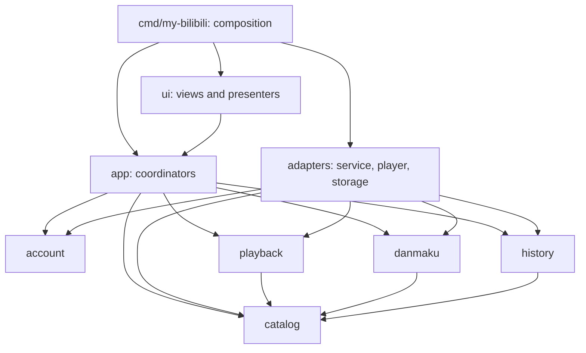

# P0 Go architecture proposal

Date: 2026-11-10 (Asia/Shanghai).
Status: design discussion, not implemented, reviewed or frozen. This refines
the proposed [P0 spec](spec.md), not the accepted architecture baseline.

## Shape and package ownership

Use one Go module and a modular monolith. Feature-sized business packages own
their external ports; adapters translate service/platform behavior into those
ports. No application JavaScript, backend service, database, event bus or
generic SDK layer is proposed. Introduce packages only with executable slices.

### Owner-confirmed Bilibili integration direction

On 2026-11-10 the owner agreed not to bind the client to a third-party Bilibili
SDK. Maintain only the adapters needed by P0, using `net/http` and explicit
response conversion behind the consuming modules' ports. Do not introduce an
SDK indirectly through a wrapper or vendored copy. Endpoint paths, permitted
signing, cookies and transport DTOs remain private to the adapters; business
code and UI use our own types.

This is not a ban on all third-party dependencies. UI/media integration,
protected storage and protobuf tooling/runtime may use separately reviewed,
pinned dependencies when needed. Source/license/access decisions and native
feasibility remain unresolved; the agreement does not approve the full
architecture or authorize implementation. Keep protocol assumptions explicit
and test conversion/error behavior with controlled fixtures.

### Proposed layout

Proposed future layout; the repository's existing development tools remain
separate and unchanged:

```text
cmd/
  dev/                         existing development CLI
  my-bilibili/main.go           composition root; builds adapters, app and UI
  package-preview/              native preview assembly, not public release
internal/
  app/                         cross-feature coordinators and plain view state
  account/                     sign-in/session lifecycle; account-owned ports
  catalog/                     stable video/part identities, search and details
  playback/                    media resolution, commands, sessions and events
  danmaku/                     timed entries, scheduling, settings and bounds
  history/                     local progress, resume and deletion policy
  ui/
    shared/                    reviewed shared widgets/styles and dispatch seam
    shell/                     navigation and feature composition
    account/ catalog/ playback/ danmaku/ history/
  adapters/
    bilibili/
      transport/               HTTP, session material, signing, safe errors
      account/ catalog/ playback/ danmaku/
    player/                    selected native player and UI-thread translation
    credentials/               platform-backed protected session storage
    localhistory/              versioned local file with safe replacement
  architecture/                executable product-import boundary tests
  testfixture/                 controlled fakes and sanitized common fixtures
integration/
  m2/                          fixture detail-to-playback loop
  p0/                          full account/catalog/player/danmaku/history loop
packaging/preview/             preview metadata/assets; no release credentials
```

### Allowed import direction



Edges represent allowed imports, not a generic runtime bus. Business modules
must not import `ui`, `app`, adapters, mygo, OS media types or service DTOs.
`app` must not import `ui`; views call app coordinators, while the entrypoint
wires a UI-safe notification/dispatch seam. A native player adapter may import
mygo/system types, but those types never occur in a business port signature.

Catalog owns the small stable video/part identity used by playback, danmaku and
history. Do not put unrelated models in a universal `common` package. Account
is not imported by every business feature: session material stays in the
injected service adapters, and account-generation invalidation is orchestrated
by `app`. Danmaku and history do not import the player adapter or consume the
same event channel directly; the coordinator maps player state to their own
consuming contracts.

Add executable import-boundary tests when the first product packages exist.
Documentation is not enforcement; the current foundation has no such product
checks yet. Proposed ownership is `P0-001`, not a change to the trusted runner.

## Boundary sketches

These are illustrative Go shapes for discussion, not complete compilable
files or frozen signatures. Concrete errors, timeouts, capacities and platform
dispatch requirements must be reviewed after feasibility.

Catalog-owned identity and external-data port:

```go
type VideoRef struct {
    BVID string
    AID  int64
}

type PartRef struct {
    Video VideoRef
    CID   int64
}

type Source interface {
    Search(ctx context.Context, query string, page int) (SearchPage, error)
    Detail(ctx context.Context, ref VideoRef) (Video, error)
}
```

The catalog adapter converts external JSON into `Video`, `Part` and
`SearchPage`; views never receive raw response objects. Resolve aliases to one
canonical video identity so a BV entry and numeric entry do not create two
history items. A part index is presentation, not stable identity. Candidate
P0 direct inputs are BV identifiers, `av` plus digits and canonical video URLs;
short-link following is not assumed without a bounded, reviewed host policy.

Playback owns two different boundaries: resolving permitted media and
controlling its presentation. Neither is a Bilibili DTO or native handle:

```go
type Resolver interface {
    Resolve(ctx context.Context, target catalog.PartRef, quality Quality) (MediaInput, error)
}

type Player interface {
    Open(ctx context.Context, input MediaInput) (Session, error)
}

type Session interface {
    Command(ctx context.Context, command Command) error
    Snapshot() Snapshot
    Events() <-chan Event
    Close() error
}
```

`MediaInput` must describe the track form the selected adapter actually needs,
including separate tracks and origin-scoped request metadata if required.
Transient media locations are sensitive: they stay inside the resolver/player
path, are not view-state fields, and are never persisted or logged. Do not
reduce this to `Play(url string)` before proving it handles target flows.

`Snapshot` contains normalized state, position, duration, rate and generation,
not native media objects. Session context lasts until switch/close. `Close`
is idempotent and completes owned teardown; canceled `Open` cannot later make
audio audible. The adapter dispatches native commands onto the required thread
without holding the UI thread during network work.

### Other consumed ports

| Consumer | Port and data it owns | Concrete adapter |
| --- | --- | --- |
| Account | Sign-in gateway, opaque credential material, protected-store operations, clock; public session snapshot excludes credentials | Bilibili account adapter plus protected storage |
| Danmaku | Timed-entry source, metadata/segments, media-time snapshot seam and scheduler settings | Bilibili danmaku adapter; app maps normalized player snapshots |
| History | Load/save progress and controllable time; no dependency on the player | Local file adapter; app records normalized progress |
| App/UI | Plain screen state and invalidation/dispatch seam; no service response or secret in state | Root wires UI dispatcher and feature views |

## Main runtime flows

### Sign-in and session

The account coordinator begins a bounded attempt, displays its short-lived QR
challenge, and polls with cancellation/deadline. The gateway retains the raw
poll key and cookies; the view receives only a local attempt identity,
ephemeral challenge presentation and safe status. QR content is sensitive even
though deliberately visible: clear it on success/expiry/dismissal and exclude
it from logs, snapshots, screenshots and recorded fixtures.

On success, protected storage must succeed before reporting a restorable
session. If it fails, expose that state rather than silently writing plaintext.
Restore requires a bounded validity check; session persistence does not promise
permanent automatic refresh. Re-login on expiry is acceptable under the
current proposed scope; automatic refresh needs a reviewed access mechanism.

Sign-out immediately invalidates the account generation, stops authenticated
playback, clears live transport session material and attempts protected-store
deletion. Report deletion failure prominently and do not claim credentials
were removed. Optional remote revocation is best effort and must not keep the
local session active if the network is down. Late polls/requests cannot revive
the session. Local history remains device-local and separately clearable.

### Open, play and change parts

1. The app cancels the previous video generation and starts catalog loading.
2. It presents normalized details and chooses a concrete part identity.
3. Playback resolves fresh permitted media; selected quality is limited to the
   returned capabilities and evaluated decoder support.
4. The player opens and produces normalized state/time events. One coordinator
   consumes `Events`; it directly updates view state, the danmaku timebase and
   progress recording. Several consumers reading one Go channel is not a
   broadcast mechanism.
5. Part/quality changes close old sessions and invalidate their events before
   installing the replacement. Retry cannot attach an obsolete source.

### Danmaku and progress

Load bounded metadata/segments around the active media position, normalize
supported ordinary text entries and schedule them against media time. The
archived source describes protobuf segments and CID-based lookup; that is a
reference to validate, not an already working service contract; see
[the source map](api-references.md#p0-api-candidate-map).

Pause freezes the overlay; seek rebuilds the active scheduling window; speed
changes use the normalized player timebase. User scroll-speed settings affect
presentation, not entry timestamps. Part/account generation changes discard
old segment work. No script/BAS execution, arbitrary markup or sender-identity
reconstruction is proposed. Unsupported modes are safely excluded and named
in the capability matrix before acceptance criteria are frozen.

History checkpoints at bounded intervals and on pause/seek/part-close/app-close.
Persist canonical video/part identity, useful progress and harmless display
metadata, never media locators. Safely replace the versioned file; retain old
data on failure and expose corruption/write problems. No database is needed.

## Shared async and network policy to freeze

- Tag operations and callbacks with video/session generations. Each owner
  cancels obsolete work and ignores late completions independently.
- Make request, sign-in attempt and teardown deadlines finite. Bound response
  bytes, protobuf decode sizes, segment cache, overlay count and subscriptions;
  set exact values from the reviewed native feasibility measurements.
- Coalesce replaceable position updates when queues fill; preserve terminal
  lifecycle outcomes. Specify event ordering and overflow before dispatch.
- Publish immutable/copy-safe view snapshots through the UI dispatcher. Never
  let background network/player callbacks call framework views directly.
- Transport owns cookies/signing, body limits, redirects and safe error mapping.
  Scope credentials and media headers to the permitted origins; do not forward
  them blindly to redirect destinations or arbitrary user-supplied URLs.
- Retry only bounded, eligible transient operations. Permission, expired login,
  verification/risk challenges and malformed data are not an invitation to
  evade controls. Surface a safe actionable state instead of exposing bodies.
- Default tests inject transport/player/clock/storage. Authorized live smoke
  is separate, never a hidden requirement of `go test` or CI.

## Native player finding and open choice

The repository's historical ADR inspected mygo revision
`e98410d0490bcaad7c81be2fc7283bfc1279e815`. This research also inspected
`daf6341a2fe05f62dc8519e7cc215a90c757e8e0`, without adopting or installing it.
Pinned source links are in the [reference notes](api-references.md#native-ui-and-player-reference).

The inspected mygo video documentation exposes controls/time queries and
requires player methods on the main thread. Its `ui/video` public open entry
points take one URL, a file or bytes; the inspected `source` only carries URL
and data. They do not expose header, separate-audio-source or context arguments.
This is a source-interface finding, not proof that all alternative integration
paths are impossible, and not a native playback test.

Therefore M1 must decide whether to use that player, extend it through a
separately reviewed adapter, or select a different native player behind the
same business boundary. Do not assume a generic MP4 demo proves service
headers, separate-track playback, cancellation, fullscreen overlays or Windows
behavior. Do not quietly introduce a localhost media proxy, custom remuxer,
external runtime or application JavaScript to conceal a failed capability;
those would require explicit new scope and architecture review.
