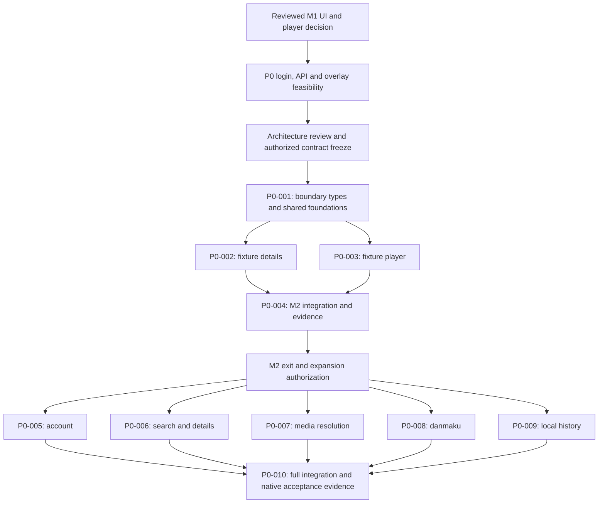

# P0 delivery plan

Date: 2026-11-10 (Asia/Shanghai).
Status: proposed plan; source inspection and document preparation only.
Product scope includes login and read-only danmaku. Neither implementation nor
delegation is started by this document. The existing M1/M2 gates still apply.

## Reading order and outputs

1. [Product scope and acceptance](spec.md).
2. This execution plan and the [implementation task DAG](tasks.json).
3. [Concrete Go architecture proposal](architecture.md).
4. [GitHub/API references and source-status caveats](api-references.md).
5. [Not-yet-dispatchable architecture-review packet](architecture-review.md).

The architecture is a proposal, not a description of existing product code.
Today the Go packages implement development checks, spec validation and local
run recording. No account, catalog, player, danmaku or desktop shell exists.

## Ordered plan

| Step | Work and deliverable | Exit / authority | Current state |
| --- | --- | --- | --- |
| 1 | Record P0 scope, features, dependencies, verification and candidate Go boundaries | Owner product discussion; detailed contract still proposed | Draft written |
| 2 | Inspect primary GitHub sources; map login/search/details/media/danmaku; record revisions, licenses and maintenance limitations | Distinguish source evidence from working endpoints and permissions | Initial reference inspection done; no Bilibili requests |
| 3 | Resolve environment and authorized native fixtures | Pinned Go available, actual macOS/Windows runtimes and safe fixture provenance; no implicit installations | Go 1.27.3 installed with Homebrew on owner request; Windows access and fixtures remain unresolved |
| 4 | Separately select/review and execute the existing serial M1 spike | Exact evaluated UI/player revision and per-OS runtime capability evidence; independent adapter decision | Not started |
| 5 | Separately scope/review P0 access and overlay feasibility | Permitted login/session/search/media/danmaku path, protected storage and timebase/fullscreen seam; no bypass or silent feature removal | Not started; needs bounded assignment |
| 6 | Set concrete ports, state machines, supported input/media formats, timeout/cap values and pinned dependencies | Independent architecture/security/native review; then authorized contract freeze | Architecture proposal ready for discussion, not approval |
| 7 | Execute `P0-001`, then details `P0-002` and fixture player `P0-003` in parallel when authorized | Non-overlapping ownership, controllable fakes, checks, exact source identities | Not started |
| 8 | Integrate the small M2 slice in `P0-004` | Independent review, bounded repair/escalation evidence, native previews and milestone disposition per stage zero | Not started |
| 9 | After expansion authorization, execute `P0-005` through `P0-009` in parallel | Feature-local behavior/tests; fake seams do not establish real cross-feature success | Not started |
| 10 | Integrate in `P0-010`, review the exact candidate and verify complete native P0 | Both target OSes, native previews, complete AC evidence, owner acceptance; no public release implied | Not started |

Steps 4 and 5 are distinct: this plan does not silently expand the existing M1
contract or authorize experimental code under a documentation request. A
separate reviewed feasibility assignment must identify any additional write
paths and safe runtime inputs before those probes run.

## Dependency view

## Parallel ownership

- Account owns its business module, feature view, service adapter and protected
  storage adapter. It does not edit the common transport while others work.
- Catalog owns search/details and their adapters/views. Its later task is
  ordered after the earlier fixture-detail task over the same paths.
- Playback owns media resolution and the native player adapter/view. Its later
  task follows the fixture-player task; no concurrent writes to the renderer.
- Danmaku owns loading/scheduling and its overlay view, using a reviewed
  timebase/presentation seam without editing playback-owned files.
- History owns progress/persistence and its view, using synthetic player
  events until final integration.
- The serial preparation task owns shared dependencies, boundary types,
  transport plumbing and executable product-import checks. Integration owns
  entrypoints, composition, navigation and native preview assembly.

Do not split into frontend/backend/test workers. Each feature includes tests.
Parallel work is conditional on real seams: if native overlay or auth coupling
requires shared writes, revise and review the task DAG instead of improvising.
The graph describes future coordination; no agents have been dispatched.

## Confirmed integration direction

Owner decision on 2026-11-10: no third-party Bilibili SDK dependency. Maintain
thin P0-specific Go adapters using Go's HTTP facilities and module-owned ports;
reference repositories inform research, not automatic dependency adoption or
source copying. Reviewed UI/media/storage/protobuf dependencies are not ruled
out. This narrow decision does not approve the remaining architecture, settle
access/reuse questions, start M1 or authorize implementation/delegation.
The feature ownership and task DAG are unchanged by this clarification.

## Decisions needed before implementation

1. Accept or replace the evaluated UI/player adapter after M1. The inspected
   upstream entry point does not itself establish required headers or separate
   audio/video support; see the architecture proposal.
2. Establish an authorized API/access route. Archived community documentation
   is historical research, not a service contract or proof of permission.
3. Confirm QR-first sign-in, read-only ordinary text danmaku, device-local
   history after sign-out and supported direct-input forms. All remain proposed
   detailed defaults within the owner-approved P0 priorities.
4. Approve an exact reviewed contract and separately authorize implementation,
   any delegation, and native test access. No remote action is inferred.

## Verification and continuation

Current base: `f9998c6bb771ebe0e3b470d0a7087fee5cf8e600`; the P0 planning
directory was already untracked from the preceding planning turn. The base is
not the identity of this changed planning candidate. No product files,
dependencies, old milestone contracts, check policy or CI have been changed.

On 2026-11-10 the owner requested Go installation, then explicitly selected
Homebrew for a global installation. `brew install go` installed Go 1.27.3;
`go` resolves to `/opt/homebrew/bin/go` without a shell-configuration change.
The earlier checksum-verified project-local installation remains available,
but subsequent checks use Homebrew Go. Local installation provenance is in
the ignored `.agent/environment.json`, not a portable prerequisite.

JSON syntax, AC-reference sanity, new-file whitespace and local document links
passed lightweight checks. The first `go run ./cmd/dev check --race` also
passed with the project-local Go before the Homebrew installation. After the
environment-note changes, rerun it with Homebrew Go; retain the exact candidate
manifest and actual result under `.agent/checks/`. Lightweight document checks
are not the repository Go validator, and neither check approves prose.
`go run ./cmd/dev run list` returned an empty list in this worktree; there is
no local run ID for `run status`. This does not erase the durable M0 handoff.
No native, service, packaging or independent-review success is claimed.

Next action: discuss the architecture and reference/access findings, then
resolve prerequisites and separately authorize the bounded M1/review work.
Before review dispatch, archive the exact candidate and record hashes/modes,
spec/task hashes, reviewer authority and environments in the assignment packet.
